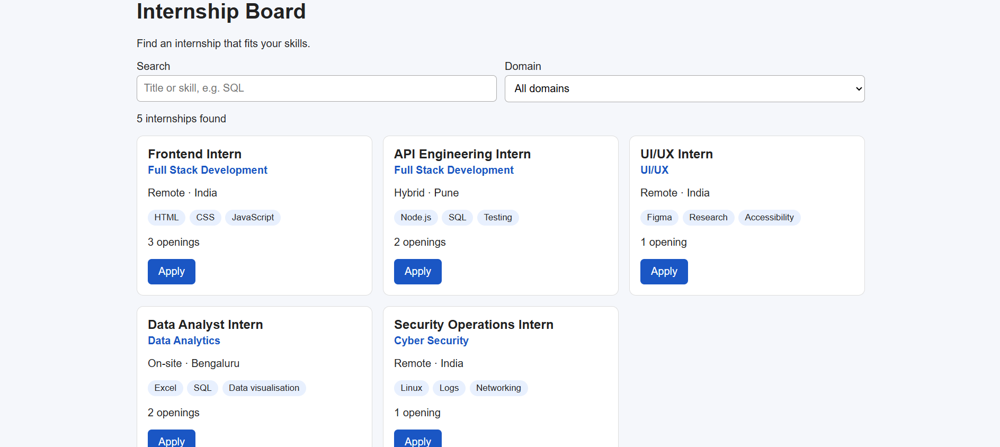
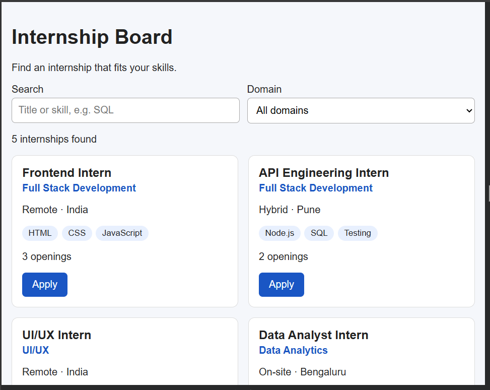
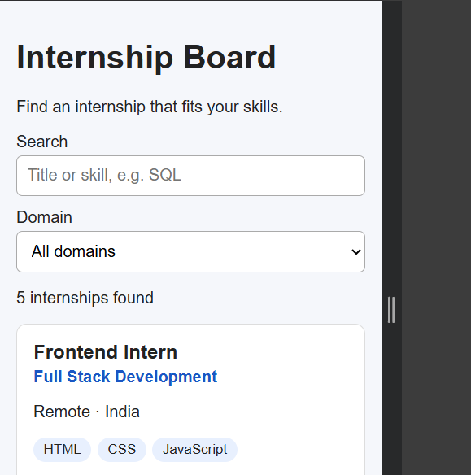

# Responsive Internship Board

An accessible internship listing page built with HTML, CSS and JavaScript (no framework).

## Features
- Internship cards loaded from a JSON file
- Search by title or skill
- Domain filter
- Empty state and error state messages
- Keyboard navigation and labelled form fields
- Responsive layout for mobile, tablet and desktop

## Live Preview
https://YOUR-USERNAME.github.io/internship-board/

## Screenshots

### Desktop

### Tablet

### Mobile

## Tech
HTML5, CSS3, JavaScript (fetch API)

*Data is fictional and used for practice.*